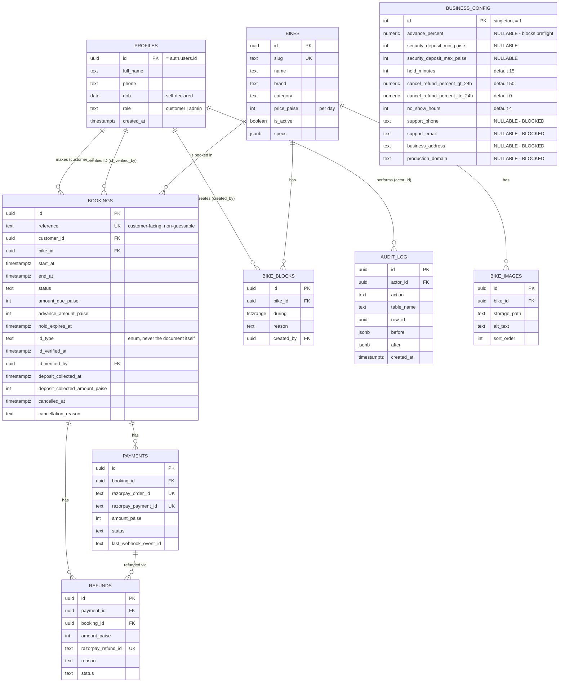
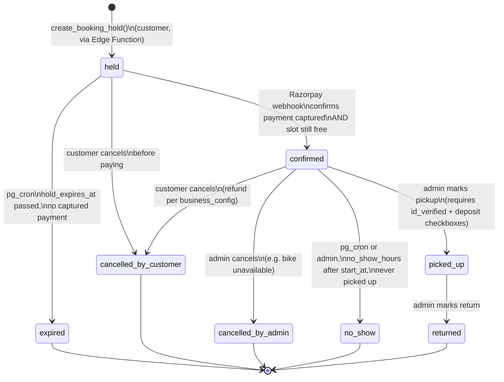

# Data model

Status: proposed, awaiting approval. Nothing here is migrated yet (Phase 0 is docs-only).

All money is stored as **integer paise** (₹1 = 100 paise) to avoid floating-point rounding in financial data. All timestamps are `timestamptz`, stored in UTC by Postgres convention; the frontend converts to Asia/Kolkata (IST, UTC+5:30, no DST) for display. Booking units are whole days: a booking's `start_at`/`end_at` are always set to IST midnight boundaries by the booking function, never arbitrary times, even though the column type is `timestamptz` (keeps the exclusion-constraint math simple and leaves room for hourly booking later without a schema change).

## Entity-relationship diagram



## Table notes

### `profiles`
One row per `auth.users` row (same `id`, 1:1), created by an `on auth.users insert` trigger. `role` defaults to `customer` and is changed **only** by a migration/SQL run as the Postgres superuser/`service_role` — never through the API, never through a client request, enforced by a `BEFORE UPDATE` trigger that rejects any `role` change attempted by a non-`service_role` session. `dob` is self-declared and explicitly documented (in the UI and in the privacy policy) as not a verified age check — the real check happens at pickup against the physical ID, per the hard rule against storing ID documents.

### `bikes`
`specs` is `jsonb` (fuel/engine/gears/mileage today) rather than fixed columns, so new spec fields don't need a migration — matches the variability already visible in `assets/js/bikes-data.js`. `price_paise` is the only price Postgres stores; the client never sends a price for anything (hard rule). `is_active = false` is how a bike is "deleted" — bookings reference `bike_id`, so a bike with any booking history is never hard-deleted (hard rule), only deactivated, which also hides it from public listings via RLS.

### `bike_images`
Supabase Storage holds the files; this table holds metadata + the storage path. Public read (bike photos need to be visible to anonymous visitors), admin-only write.

### `bike_blocks`
Maintenance/unavailable windows the admin sets manually (bike in the shop, etc.) — distinct from `bookings` so "why is this bike unavailable" has a real reason attached, and so the exclusion constraint (below) can cover both booking overlaps and maintenance overlaps with one mechanism.

### `bookings` — the core table

- `reference`: a short, non-sequential, non-guessable customer-facing ID (e.g. `nanoid()`-style, generated server-side), separate from the internal `id` (uuid). Used in confirmation emails and the "my bookings" UI instead of the raw database `id`, so a reference never leaks internal row-count/ordering information and can't be brute-forced in a short loop the way a sequential ID could.
- `id_type` is an enum (`aadhaar | voter_id | passport | driving_licence`) — **no document, image, or number is ever stored**, per the hard rule. `id_verified_at`/`id_verified_by` record that an admin physically checked an ID at pickup, nothing about the ID itself.
- `deposit_collected_at`/`deposit_collected_amount_paise` record that cash/UPI changed hands *offline* at pickup (v1 has no online deposit collection, per the DECISIONS table) — this is a record of a real-world event the admin attests to, not a payment this system processes.
- **The double-booking guard**:

  ```sql
  create extension if not exists btree_gist;

  alter table bookings add constraint bookings_no_overlap
    exclude using gist (
      bike_id with =,
      tstzrange(start_at, end_at) with &&
    ) where (status in ('held', 'confirmed', 'picked_up'));
  ```

  This is enforced by Postgres itself at `INSERT`/`UPDATE` time, independent of any application code path — two concurrent transactions both trying to hold the same bike for overlapping dates can't both succeed; the second one gets a constraint-violation error that the booking function translates into a clean "no longer available" response. `bike_blocks` ranges are checked by the availability *query* (not this constraint, since blocks aren't bookings), but a future migration could extend the exclusion constraint to cover both via a combined view if block-vs-booking races become a real concern.

### `payments` / `refunds`
One `bookings` row can have more than one `payments` row over its life (a failed attempt, then a successful one) — `payments` is append-only per attempt, never edited in place, so the full history of what Razorpay actually said is preserved for reconciliation. `refunds` similarly records every refund attempt against a `payments` row. Reconciliation ("amounts match across bookings/payments/refunds", required by Phase 4's acceptance criteria) is a query that sums `payments.amount_paise` (status=`captured`) minus `refunds.amount_paise` (status=`processed`) per booking and compares it against `bookings.advance_amount_paise`.

### `business_config`
A singleton row (`id` constrained to `1`) rather than a key-value table, so every config field is a typed, constrained column instead of untyped text — a migration adds a column when a new config value is needed, which also makes "this value doesn't exist yet" (NULL) trivially distinguishable from "this value is zero" for the preflight check. Every `BLOCKED ON THE CLIENT` value (SECURITY_AUDIT.md-adjacent: phone, email, address, domain, advance %, deposit range) starts `NULL` and the Phase 8 preflight script fails the build if any of them are still `NULL`.

### `audit_log`
Populated by a trigger (`AFTER INSERT OR UPDATE` on `bikes`, `bike_blocks`, `bookings`, `business_config`) that writes `before`/`after` as `jsonb` snapshots — not by application code remembering to call a logging function, so it can't be silently skipped by a code path that forgets.

## Booking state machine



| From | To | Who/what triggers it | Notes |
|---|---|---|---|
| *(none)* | `held` | Customer, via `create_booking_hold` Edge Function | Exclusion constraint is the final guard against a race with another `held`/`confirmed`/`picked_up` row |
| `held` | `confirmed` | Razorpay webhook only (not the client-side "payment succeeded" callback — that's a UX signal, not a trust boundary) | If the hold already expired by the time the webhook arrives, see Phase 4's two-branch handling: confirm if the slot is still free, otherwise auto-refund |
| `held` | `expired` | `pg_cron` job on a schedule (e.g. every minute) | Releases the slot for others; no customer action needed |
| `held` | `cancelled_by_customer` | Customer, before paying | Rare path (closed the tab mid-checkout, came back and explicitly cancelled) — no refund needed since nothing was captured |
| `confirmed` | `picked_up` | Admin only, UI requires ticking "ID verified" (+ `id_type`) and "deposit collected" | These two checkboxes are what set `id_verified_at`/`deposit_collected_at` |
| `confirmed` | `cancelled_by_customer` | Customer, via Phase 6 cancellation flow | Refund amount computed server-side from `business_config` cancellation rules, shown as a preview before the customer confirms |
| `confirmed` | `cancelled_by_admin` | Admin only | E.g. bike broke down and no replacement is available; triggers a full refund (business decision to confirm — see Open Questions) |
| `confirmed` | `no_show` | `pg_cron` (or admin override) | `no_show_hours` (default 4) after `start_at` with no pickup; no refund per pricing-policy.html |
| `picked_up` | `returned` | Admin only | Terminal happy-path state |

**Not modeled as a transition in v1**: mid-rental incidents (accident, breakdown while out) — pricing-policy.html's damage/liability clauses apply, but there's no `bookings.status` for "bike out, something went wrong"; that's handled outside this state machine (a support conversation), consistent with "no fake features" — this project isn't claiming to track incident handling it doesn't actually build.

## Open questions for Phase 0 approval

1. **`cancelled_by_admin` refund amount** isn't specified in the DECISIONS table or the pricing policy (which only covers *customer*-initiated cancellation timing). Defaulting to a full refund when the admin cancels (since the customer did nothing wrong) unless told otherwise.
2. **Refund processing time** (pricing-policy.html says "7-10 working days") is a *range*; `business_config` stores it as two integers (`refund_processing_days_min`/`max`) for display text, but the actual Razorpay refund API call happens immediately on the backend — the 7-10 days is Razorpay/the bank's settlement time, not something this system controls or needs to schedule.
3. **Multi-day vs. per-day granularity for `bike_blocks`**: modeled as a `tstzrange` (same shape as bookings) so partial-day maintenance blocks are representable even though bookings themselves are always whole-day — confirms with the "whole days" decision rather than fighting it.
